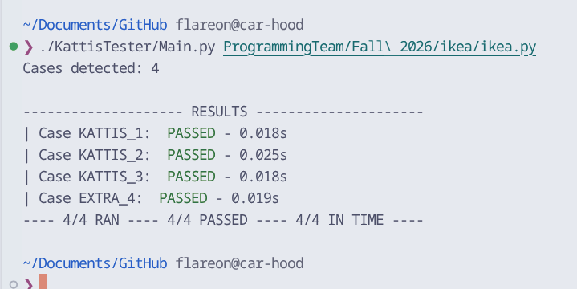
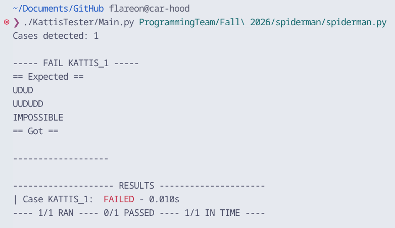

A simple test program for Python programs. Compares an expected output with the true output of the program.


Requirements:
- Python (I used Python 3.14.7) but any version with subprocess, argparse, os, and time should work fine

In the folder where your python script is located, make sure your files are organized as such:

```plaintext
ikea/
├── ikea.py
├── in
│   ├── EXTRA_4
│   ├── KATTIS_1
│   ├── KATTIS_2
│   └── KATTIS_3
└── out
    ├── EXTRA_4
    ├── KATTIS_1
    ├── KATTIS_2
    └── KATTIS_3
```

File names must match between the in/ and out/ directories, otherwise, the case will be ignored.

The following arguments can be passed:
```
  -h, --help         show this help message and exit
  -v, --verbose      Increase output verbosity
  -c, --case CASE    Specify specific case to run
  -t, --limit LIMIT  Time limit (in seconds) for grading. (default 1)
```

The final argument must be the script you would like to test (i.e., ikea.py). Relative paths may be used.



*Sample usage with relative paths*

The following results may occur per case:
- PASSED: The program's output matches the expected output
- FAILED: The programs output doesn't match the expected output
- TIME EXCEEDED: The runtime of the program exceeded the specified limit
- EXIT CODE {CODE}: The program did not successfully execute. 


*Sample fail*

For any issues with the software, you are free to open a GitHub issue, thanks!